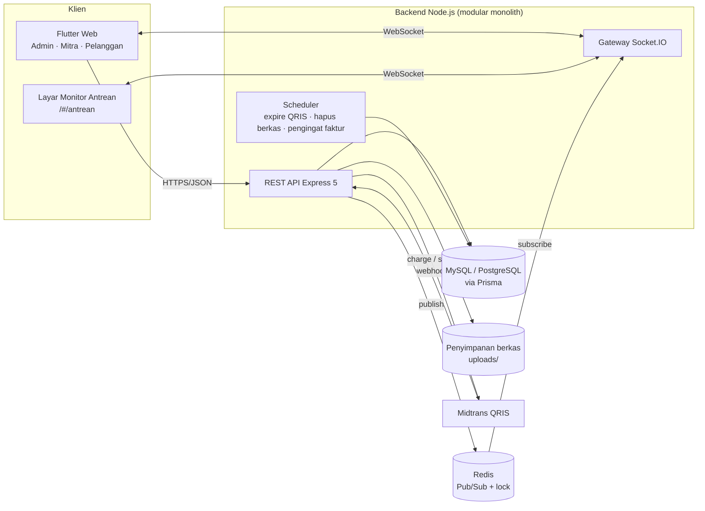
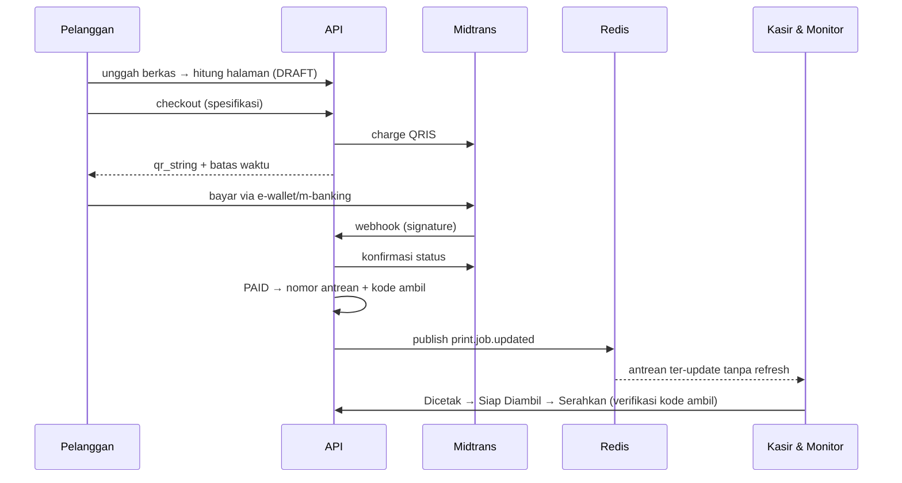

# Arsitektur Sistem Talago Royal

Dokumen ini menjelaskan arsitektur yang diimplementasikan, alasan setiap keputusan, fitur tambahan di luar proposal, dan saran pengembangan berikutnya. Bisa dipakai sebagai bahan SDD.

## 1. Gambaran umum



**Gaya arsitektur: _modular monolith_.** Satu proses Node.js dibagi per modul domain (`auth`, `inventory`, `sales`, `b2b`, `printing`, `payments`, `reports`, `settings`, `notifications`). Untuk tim 5 orang dalam 16 minggu, microservices hanya menambah biaya (deploy, observabilitas, konsistensi data) tanpa manfaat nyata. Batas modul tetap jelas sehingga kelak bisa dipecah jika diperlukan.

```
backend/src
├── config/        env & zona waktu
├── lib/           prisma, event bus Redis, socket, sequence, pdf, settings, notify/audit
├── middleware/    auth (JWT + RBAC), error handler
├── modules/<domain>/   *.routes.js (HTTP) · *.service.js (logika) · fungsi murni (units.js, pricing.js)
└── jobs/          scheduler
```

## 2. Keputusan desain penting (dan saran saya terhadap proposal)

### 2.1 Stok selalu disimpan dalam satuan terkecil
Kolom `products.stock` adalah **integer satuan terkecil** (Pcs/Lembar). Dus/Pak hanyalah *tampilan* hasil konversi (`137 Pcs` → `2 Dus 1 Pak 5 Pcs`). Konsekuensinya:
- tidak pernah ada pembulatan atau selisih karena konversi,
- penjualan campuran satuan (1 Dus + 45 Pcs) cukup dijumlahkan,
- hierarki divalidasi **bertingkat**: konversi satuan besar harus habis dibagi satuan di bawahnya (Dus=60, Pak=12 valid; Dus=50, Pak=12 ditolak).

### 2.2 Ledger mutasi stok (append-only)
Setiap perubahan stok menulis baris `stock_movements` (jenis, qty bertanda, saldo setelahnya, referensi dokumen, petugas). Inilah sumber "riwayat keluar-masuk barang", dasar Smart Restock Alert, dan jejak audit saat terjadi selisih.

### 2.3 Anti race-condition
- Pengurangan stok memakai `UPDATE … WHERE stock >= qty` (atomik) — dua kasir/PO bersamaan tidak bisa membuat stok minus.
- Transisi status (approve PO, update antrean, catat pembayaran) memakai *optimistic locking* (`updateMany where status = <lama>`).
- Penomoran dokumen (PO, INV, POS, antrean C001…) memakai tabel `counters` yang dikunci per baris.

### 2.4 Redis Pub/Sub dipakai dengan benar
Proposal menyebut "antrean real-time berbasis Redis Pub/Sub". Dua catatan penting:
1. **Pub/Sub bukan penyimpanan antrean** — pesan bersifat *fire-and-forget*. Status antrean yang sah disimpan di **database**; Redis hanya membawa *notifikasi perubahan*. Klien yang terlewat pesan cukup memuat ulang dari API.
2. **Browser tidak bisa terhubung langsung ke Redis.** Karena itu ada **gateway Socket.IO**: API `PUBLISH` ke channel `talago:events` → setiap instance backend `SUBSCRIBE` → diteruskan ke room `staff`, `user:<id>`, atau `public`. Pola ini membuat real-time tetap sinkron saat backend di-*scale* ke beberapa instance.
Tanpa `REDIS_URL`, event bus otomatis memakai `EventEmitter` (cukup untuk 1 instance / development).

### 2.5 Pembayaran: satu jalur untuk semua sumber
`processPaymentUpdate()` adalah satu-satunya fungsi yang mengubah status pembayaran — dipanggil oleh webhook Midtrans, tombol *Cek status*, scheduler, maupun simulasi. Sifatnya **idempoten** (notifikasi ganda aman). Webhook diverifikasi dengan *signature* SHA-512 dan dikonfirmasi ulang ke API status Midtrans. Aturan bisnis "masuk antrean setelah QRIS tervalidasi" ditegakkan di fungsi ini.



### 2.6 Penghitungan halaman dokumen Word
Jumlah halaman Word bergantung font & printer, sehingga metadata `.docx` hanya perkiraan dan `.doc` tidak bisa dibaca andal. **Saran:** pasang LibreOffice (`SOFFICE_PATH`) atau layanan **Gotenberg** (Docker) untuk mengonversi Word → PDF saat unggah. Hasil PDF itulah yang dicetak operator, jadi halaman yang ditagihkan = halaman yang dicetak. Berkas juga divalidasi via *magic bytes*, bukan sekadar ekstensi.

### 2.7 Uang sebagai integer Rupiah
Semua nominal disimpan sebagai integer Rupiah (tanpa desimal) — menghindari galat floating point. Batas `INT` MySQL ±Rp 2,1 miliar per nilai; cukup untuk satu faktur ATK. Jika kelak perlu, ubah ke `BigInt`/`Decimal`.

### 2.8 MySQL atau PostgreSQL?
Proposal menyebut keduanya. Implementasi memakai **Prisma** sehingga cukup mengganti `provider` di `schema.prisma` lalu membuat migrasi baru. Development memakai MySQL karena sudah tersedia di Laragon. Untuk production saya **menyarankan PostgreSQL** (transaksi & locking lebih ketat, `CHECK` constraint, JSONB, managed service murah seperti Neon/Supabase). Satu query mentah yang perlu dicek saat migrasi: `SELECT … FOR UPDATE` (kompatibel) dan nama kolom camelCase di laporan (gunakan tanda kutip ganda di PostgreSQL).

### 2.9 Keamanan
- JWT + RBAC (OWNER, ADMIN, B2B, CUSTOMER) ditegakkan **di backend** pada setiap route; UI hanya menyembunyikan menu.
- Mitra hanya bisa mengakses PO/faktur miliknya (diuji di smoke test).
- Token unduhan PDF/berkas berumur 2 menit dan terikat ke satu path (tautan tidak bisa dipakai ulang untuk dokumen lain).
- Kode ambil 6 digit tidak ditampilkan ke staf → staf wajib memverifikasi ke pelanggan saat serah terima.
- Rate limit login, Helmet, validasi input Zod (pesan berbahasa Indonesia), batas ukuran unggahan, retensi berkas otomatis, jejak audit (`audit_logs`).

## 3. Fitur tambahan di luar proposal

| Fitur | Alasan |
|---|---|
| **Kasir / POS eceran multi-satuan** | Proposal menyebut stok dipotong dari transaksi *retail*, tetapi tidak ada modul penjualan eceran. Tanpa ini stok hanya berkurang dari PO B2B. |
| **Stock opname** (hitung fisik campuran Dus/Pak/Pcs) | Akar masalah proposal adalah "selisih hitung"; opname adalah alat koreksinya, tercatat di ledger. |
| **Penerimaan barang + HPP rata-rata tertimbang** | Stok masuk terdokumentasi (pemasok, no. surat jalan) dan valuasi aset akurat. |
| **Smart Restock "prediktif"** | Selain "di bawah batas minimum", level **Waspada** memprediksi barang yang akan habis sebelum pasokan datang (kecepatan jual 30 hari vs lead time). Fast-moving ditentukan otomatis (20% teratas), plus saran jumlah pesan dibulatkan per Dus. |
| **Level mitra, termin (TOP) & limit kredit** | "Harga berbasis profil instansi" → level Reguler/Silver/Gold/Platinum; limit kredit mencegah piutang menumpuk. |
| **PPN di faktur (bisa 0%)** | Instansi pemerintah/sekolah umumnya butuh faktur dengan PPN. |
| **Aging report piutang + pengingat jatuh tempo otomatis** | Melengkapi "pelacakan status Lunas / Jatuh Tempo". |
| **Pesan ulang (reorder) & tempel dari Excel** | Pengadaan instansi bersifat rutin; admin pengadaan bekerja di spreadsheet. |
| **Rentang halaman, jumlah rangkap, bolak-balik** | Kebutuhan umum jasa fotokopi yang belum ada di proposal. |
| **Kode ambil + layar monitor antrean publik** | Mencegah salah serah berkas; pelanggan di toko melihat nomor dipanggil. |
| **Kedaluwarsa QRIS + bayar ulang** | QRIS dinamis punya batas waktu; pesanan tidak menggantung. |
| **Notifikasi in-app real-time** | "Notifikasi kesiapan pengambilan" + PO disetujui, faktur, stok menipis, mitra baru. |
| **Laporan omzet per kanal, produk terlaris, dead stock** | Kebutuhan pemilik toko akan data yang rapi. |
| **Mode simulasi pembayaran** | Demo, UAT, dan pengembangan tanpa akun payment gateway. |
| **Dataset 1.020 SKU + berkas sampel uji** | Deliverable "Dataset & Data Uji" pada proposal. |

## 4. Saran pengembangan berikutnya (prioritas)

1. **Integration test dengan database uji** (mis. `node:test` + MySQL/PostgreSQL di Docker/CI) — saat ini ada unit test + smoke test end-to-end.
2. **TypeScript di backend** dan model data bertipe di Flutter (`freezed`/`json_serializable`) untuk mengurangi bug saat tim bertambah.
3. **Refresh token** (access token 15 menit + refresh token di-rotate) menggantikan JWT 8 jam.
4. **Penyimpanan berkas di object storage** (S3/MinIO/Cloudflare R2) dengan *presigned URL* — wajib bila backend lebih dari satu instance.
5. **Antrean job tahan-gagal** (BullMQ di atas Redis) untuk konversi dokumen & scheduler bila beban tumbuh.
6. **Cetak struk thermal** dari kasir (ESC/POS via browser) dan **barcode scanner** untuk SKU.
7. **Notifikasi WhatsApp/email** (mis. Fonnte/WA Cloud API) untuk "siap diambil" & jatuh tempo.
8. **Observabilitas**: log terstruktur (pino), Sentry untuk error frontend/backend.

## 5. Topologi deployment yang disarankan

```
[Cloudflare / Nginx (HTTPS)]
   ├── /            → Flutter Web (static)   ← atau backend dengan WEB_DIR
   ├── /api, /socket.io → Node.js (PM2/Docker, ≥1 instance, sticky session untuk Socket.IO)
   ├── PostgreSQL (managed)
   └── Redis (managed / container)
```

Implementasinya sudah tersedia sebagai kontainer: `docker-compose.yml` menjalankan `mysql`, `redis`, `backend` (migrasi otomatis saat start), dan `frontend` (Nginx yang menyajikan Flutter Web sekaligus reverse proxy `/api` & `/socket.io`). Pipeline GitHub Actions (`.github/workflows/ci-cd.yml`) menguji, mempublikasikan image ke GHCR, lalu men-deploy ke server via SSH. Langkah lengkap: [CARA_MENJALANKAN.md](CARA_MENJALANKAN.md) bagian D.

Di production: `JWT_SECRET` acak ≥32 karakter, `PAYMENT_PROVIDER=midtrans`, `SEED_IF_EMPTY=false`, dan port MySQL/Redis tidak dibuka ke internet.

## 6. Ringkasan endpoint API

| Prefix | Akses | Contoh endpoint |
|---|---|---|
| `/api/auth` | publik / login | `POST login`, `register`, `register-partner`, `GET me`, `POST download-token` |
| `/api/inventory` | staf | `products`, `categories`, `receipts`, `opnames`, `movements`, `restock-alerts`, `summary` |
| `/api/sales` | staf | `POST /` transaksi kasir, `GET /` riwayat |
| `/api/b2b` | mitra | `catalog`, `quote`, `orders`, `invoices`, `invoices/:id/pdf`, `summary` |
| `/api/admin/b2b` | staf | `orders/:id/approve|reject|ready|complete|cancel`, `invoices/:id/payments`, `receivables` |
| `/api/partners` | staf (level: pemilik) | daftar, `verify`, `reject`, ubah syarat, `levels` |
| `/api/print` | pelanggan/mitra, staf | `jobs` (unggah), `quote`, `checkout`, `check-payment`, `queue`, `queue/:id`, `queue/public` |
| `/api/payments` | webhook / simulasi | `midtrans/notification`, `mock/:orderId/pay`, `config` |
| `/api/reports` | staf | `dashboard`, `sales`, `inventory` |
| `/api/settings` | staf (ubah: pemilik) | `store` (publik), `store_profile`, `print_pricing`, `b2b` |
| `/api/users` | pemilik | kelola akun staf |
| `/api/notifications` | login | daftar, tandai dibaca |

Event real-time (Socket.IO): `print.job.updated`, `print.queue.updated`, `stock.changed`, `stock.alert`, `order.updated`, `invoice.updated`, `sales.created`, `notification`.
